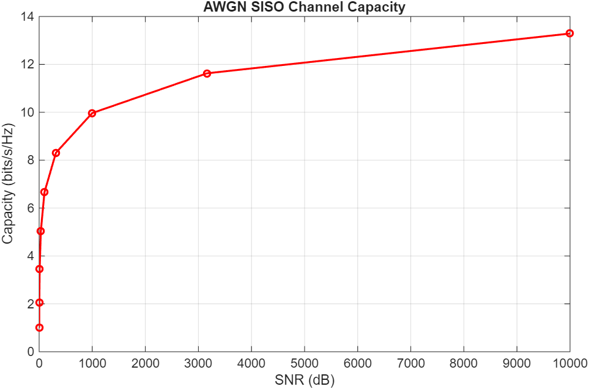
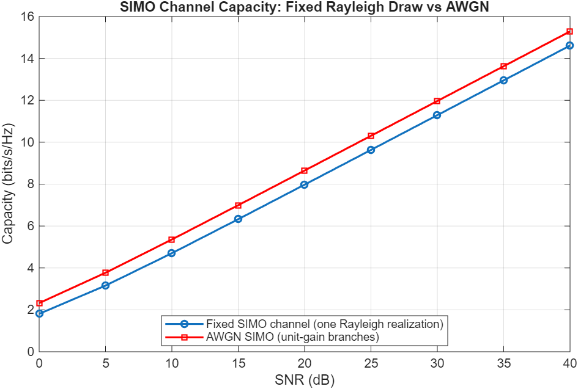
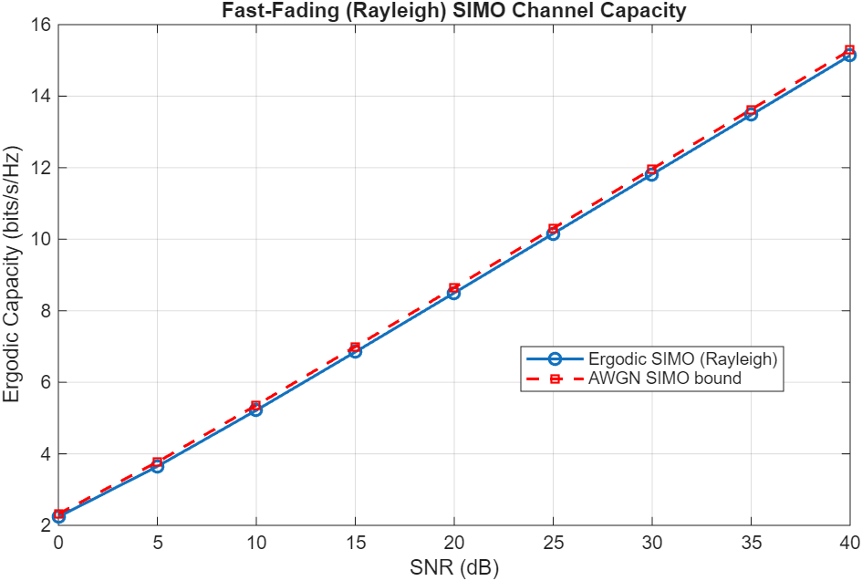
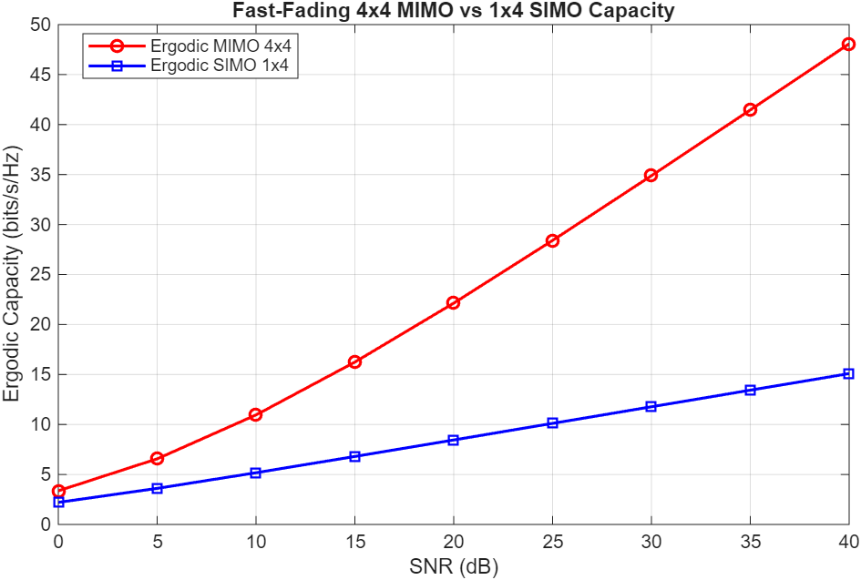
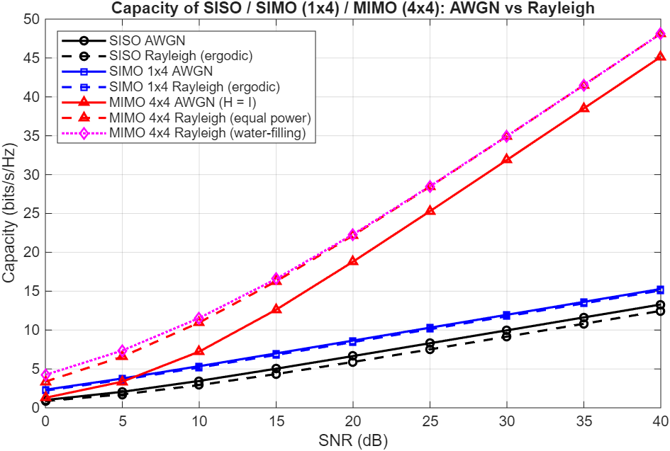
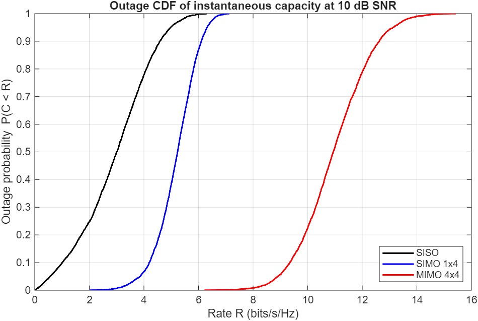

# Capacity of SISO, SIMO and MIMO Channels under AWGN and Rayleigh Fading

Course project for EE677 (MIMO Wireless Communication), October 2025.
MATLAB simulations of channel capacity for 1x1, 1x4 and 4x4 antenna setups, from 0 to 40 dB SNR.

The goal is to see, with numbers and plots, where the gains from extra antennas come from. There are two separate gains. Receive antennas give an array gain (the curve moves up). Multiple transmit and receive antennas give a multiplexing gain (the curve gets steeper).

## Contents

| File | What it does |
|---|---|
| `Q1.m` | SISO capacity in AWGN |
| `Q2.m` | 1x4 SIMO, one fixed Rayleigh draw vs the AWGN SIMO channel |
| `Q3.m` | 1x4 SIMO, ergodic capacity under fast Rayleigh fading |
| `Q4.m` | 4x4 MIMO ergodic capacity vs 1x4 SIMO |
| `Q5_combined.m` | All cases on one plot, water-filling, outage CDF |
| `Figure_1.png` to `Figure_4.png` | Output of Q1 to Q4 |
| `Result5.png`, `Result6.png` | Output of Q5 |

## How to run

Open MATLAB and run each script. No toolboxes are needed except the base `table` function. `Q5_combined.m` has a local function at the end of the file, so it needs MATLAB R2016b or newer. Q5 takes a few seconds because of the water-filling loop.

Every script that uses random numbers starts with `rng(1)`, so results repeat from run to run.

## Common setup

- SNR from 0 to 40 dB in steps of 5 dB. Linear SNR is `10^(SNR_dB/10)`.
- Noise power is 1, so SNR is the total transmit power.
- Rayleigh channel: every entry of H is complex Gaussian with zero mean and unit variance. In code, `(randn + 1i*randn)/sqrt(2)`. The division by `sqrt(2)` matters. Without it the SNR is 3 dB too high per entry.
- The receiver knows the channel (CSIR). The transmitter does not, except in the water-filling curve in Q5.
- With four transmit antennas, the total power is split equally, so each antenna sends SNR/4. This keeps the comparison with SISO fair.
- Capacity is in bits/s/Hz.

## Q1. SISO in AWGN

Model: `y = x + n`. Capacity is

```
C = log2(1 + SNR)
```



| SNR (dB) | 0 | 5 | 10 | 15 | 20 | 25 | 30 | 35 | 40 |
|---|---|---|---|---|---|---|---|---|---|
| C (bits/s/Hz) | 1.00 | 2.06 | 3.46 | 5.03 | 6.66 | 8.31 | 9.97 | 11.63 | 13.29 |

What the result shows:

- At 0 dB the capacity is exactly 1 bit/s/Hz.
- At low SNR the curve is almost a straight line in linear SNR, because `log2(1+x)` is about `1.44x` for small x. Power is the limit here.
- At high SNR the "1" inside the log stops mattering, and capacity becomes `log2(SNR)`. On a dB axis this is a straight line.
- That straight line has a slope of 3.32 bits per 10 dB, or about 1 bit for every 3 dB. You can check it in the table: 13.29 - 9.97 = 3.32 between 30 and 40 dB.
- This slope is the number of spatial streams, which is 1 for SISO. It is the number to keep in mind for the later cases.

## Q2. SIMO, fixed channel vs AWGN

Model: one transmit antenna, four receive antennas, `y = h x + n`. With maximal ratio combining, the four antennas act like one antenna with SNR multiplied by `||h||^2`:

```
C = log2(1 + ||h||^2 * SNR)
```

Two cases are plotted:

- **AWGN SIMO.** Every branch has unit gain, so `||h||^2 = 4` and `C = log2(1 + 4*SNR)`.
- **Fixed Rayleigh SIMO.** One channel is drawn once and kept fixed. This is the instantaneous capacity of that one draw.



What the result shows:

- Both curves are parallel to the SISO curve. Same slope, so still one stream. The extra antennas only move the curve.
- The AWGN SIMO curve is 2 bits above SISO at high SNR. That is `log2(4)`, which is the same as a 6 dB shift to the left (`10*log10(4)`). This is the **array gain**. It does not need fading to exist.
- The fixed Rayleigh curve is about 0.5 to 0.7 bits below the AWGN curve. This particular draw has `||h||^2` of about 2.5, which is lower than the average of 4. The script prints the exact value.
- The AWGN curve uses the average gain. A single draw can land above or below it. With another seed, this curve moves.
- The transmitter does not need to know h. With one transmit antenna there is nothing to adapt.

## Q3. SIMO, ergodic capacity under fast fading

Now the channel changes from block to block and the codeword is long enough to see many blocks. The achievable rate is the average of the instantaneous capacity:

```
C_erg = E[ log2(1 + ||h||^2 * SNR) ]
```

This is estimated with 1000 random channels per SNR point. The AWGN SIMO curve is added as a reference.



What the result shows:

- The ergodic curve sits just under the AWGN curve. This is Jensen's inequality. The log is concave, so the average of the log is smaller than the log of the average. Fading cannot raise average capacity.
- The gap is small: roughly 0.1 bit at 0 dB and about 0.19 bits at high SNR. In theory the high-SNR gap is `2 - psi(4)/ln(2)`, where `psi` is the digamma function. That evaluates to 0.19.
- The slope is the same 3.32 bits per 10 dB. Fading changes the offset, not the slope.
- The gap is small because four antennas average out the fading (`||h||^2` is a sum of four terms, so it stays close to its mean of 4). This is called channel hardening. For a single antenna the same gap is about 0.83 bits, which is visible in the SISO curves of Q5.

## Q4. 4x4 MIMO ergodic capacity

Model: `y = H x + n`, H is 4x4. With equal power from all transmit antennas and no channel knowledge at the transmitter:

```
C = log2 det( I + (SNR/nt) * H * H^H )
    = sum over i of log2( 1 + (SNR/nt) * lambda_i )
```

The `lambda_i` are the eigenvalues of `H*H^H`. The second form comes from the singular value decomposition. It splits the MIMO channel into four independent parallel channels (eigenmodes), and the capacities of parallel channels add up. This is the line the code uses.

The script draws 1000 channels, computes the four eigenvalues of each, and averages the capacity. The 1x4 SIMO curve comes from the first column of the same H.



Approximate values read from the plot:

| SNR (dB) | 0 | 10 | 20 | 30 | 40 |
|---|---|---|---|---|---|
| MIMO 4x4 | 3.3 | 11.0 | 22.2 | 34.9 | 48.0 |
| SIMO 1x4 | 2.2 | 5.2 | 8.4 | 11.8 | 15.1 |

What the result shows:

- The MIMO curve gets steeper. From 30 to 40 dB it gains about 13.2 bits, against 3.3 bits for SIMO. The slope is `min(nt, nr) = 4` times larger, because the channel carries four streams at once. This is the **multiplexing gain**.
- At 40 dB, MIMO is about 3.2 times SIMO.
- At high SNR the MIMO capacity is close to `4*log2(SNR) - 5.08`. The -5.08 has two parts. One is -8 (`-4*log2(4)`) from splitting power over four antennas. The other is +2.92, which is the average of `log2` of the four eigenvalues. This is not a negative array gain. It is the cost of splitting power and of uneven eigenvalues. The slope wins it back quickly.
- At low SNR, capacity depends on the total power the receiver collects, and both MIMO and SIMO collect the same amount to first order (`4*SNR`). So multiplexing gives nothing there, only the receive array gain. On this plot the first points are 0 and 5 dB, which are not low enough to see this limit, so MIMO is already ahead at 0 dB.
- Sanity check printed by the script: the four mean eigenvalues should add up to about 16, which is `nt*nr`. If you get about 32, the `sqrt(2)` is missing.
- The MIMO curve must stay below `4*log2(1+SNR)`. That is the Jensen bound, obtained by replacing `H*H^H` with its average `nt*I`. At 40 dB this is 53.15, and the simulation gives about 48.

## Q5. Everything together, and outage

`Q5_combined.m` puts all cases on one plot with 5000 channel draws:

- SISO AWGN and SISO Rayleigh (ergodic)
- SIMO 1x4 AWGN and Rayleigh (ergodic)
- MIMO 4x4 AWGN, Rayleigh with equal power, and Rayleigh with water-filling (transmitter knows H)

It also prints the high-SNR slopes and the array gain, and draws the outage CDF at 10 dB.

### Capacity comparison



What the result shows:

- Three groups of curves. SISO at the bottom, SIMO a constant distance above it (array gain), and MIMO far above with a much steeper slope (multiplexing gain).
- SISO Rayleigh is about 0.8 bits below SISO AWGN. SIMO Rayleigh is almost on top of SIMO AWGN. Again, more antennas mean less loss from fading.
- Water-filling helps only at low SNR. At 0 dB it gives about one extra bit over equal power (roughly 4.3 against 3.3). By 15 to 20 dB the two curves are the same. At low SNR it pays to put the power on the strongest eigenmodes. At high SNR all modes are worth using, so equal power is already almost optimal.
- About the MIMO AWGN curve: it uses `H = I` (four parallel channels with unit gain), which gives `4*log2(1+SNR/4)`. This channel has a total gain of 4, while the Rayleigh channel has an average total gain of 16. So the two are not a like-for-like pair, and the AWGN curve here is not an upper bound. It even falls below the Rayleigh curve at high SNR. A matched reference would be `H = 2I`, which gives `4*log2(1+SNR)` (53.15 at 40 dB) and sits above the Rayleigh curve as Jensen predicts. The SIMO case does not have this problem because `h = ones` already has the right total gain.

### Outage

When the channel stays fixed for the whole codeword (slow fading), no average over fades happens. A rate R works only if the capacity of that draw is above R, and outage means it is not. The plot is the CDF of the instantaneous capacity at 10 dB: the probability that capacity falls below R.



Read from the plot (approximate):

| | SISO | SIMO 1x4 | MIMO 4x4 |
|---|---|---|---|
| Median capacity | about 3 | about 5.3 | about 10.8 |
| Rate supported 90% of the time (10% outage) | about 1 | about 4.2 | about 9 |

What the result shows:

- For SISO the 10% outage rate is only about 1 bit/s/Hz, far below its average of about 3.5. A fixed-rate link has to be designed for the bad fades.
- SIMO lifts that guaranteed rate to about 4.2, close to its median. The SIMO curve is also the steepest of the three. Combining four antennas makes the received SNR much less variable.
- MIMO supports about 9 bits/s/Hz at 10% outage.
- Closed-form check for the SISO and SIMO numbers: for Rayleigh fading the outage rate comes from `P_out = F(x)` with `x = (2^R - 1)/SNR`. The 10% points work out to 1.04 for SISO and 4.21 for SIMO. The plot agrees.

Diversity: this plot shows the benefit of several antennas as a better outage rate at one SNR. It does not measure the diversity order. The diversity order is the slope of the outage probability against SNR on a log scale (about -1 for SISO, -4 for 1x4 SIMO, and up to -16 for 4x4 MIMO at a fixed rate). That would need a separate plot of `P_out` against SNR, which is not in this repo.

## Summary

| Case | Slope (bits per 10 dB) | Offset at high SNR | Source of gain |
|---|---|---|---|
| SISO AWGN | 3.32 | 0 | reference |
| SIMO 1x4 AWGN | 3.32 | +2 bits (6 dB) | array gain |
| SIMO 1x4 Rayleigh, ergodic | 3.32 | about +1.81 bits | array gain, minus a small fading loss |
| MIMO 4x4 Rayleigh, ergodic | about 13.3 | about -5.08 bits against `4*log2(SNR)` | multiplexing gain |

Points to remember:

1. Receive antennas move the curve. Multiple transmit and receive antennas change its slope.
2. The slope is the number of streams, `min(nt, nr)`.
3. Fading lowers average capacity (Jensen). The loss shrinks as antennas are added.
4. Diversity only has meaning when the channel is random. It improves reliability (outage), which the ergodic curves do not show well.
5. Transmitter channel knowledge helps at low SNR and hardly at all at high SNR.

## Limitations

- Results come from Monte Carlo with a fixed seed. With 1000 draws the error in an average is about 0.02 bits, and with 5000 draws it is smaller. Differences smaller than that are not meaningful.
- The Q2 fixed-channel curve depends on a single draw.
- Channel entries are i.i.d. Rayleigh. Correlated antennas, line of sight (Rician fading), and practical modulation and coding are not covered.
- Ergodic capacity assumes fast fading with long coded blocks. The outage plot covers the slow-fading case at one SNR only.
- The MIMO AWGN reference in Q5 is `H = I`, which is not matched in total gain (see the Q5 notes).

## References

1. C. E. Shannon, "A Mathematical Theory of Communication," 1948.
2. I. E. Telatar, "Capacity of Multi-antenna Gaussian Channels," European Transactions on Telecommunications, 1999.
3. L. Zheng and D. Tse, "Diversity and Multiplexing: A Fundamental Tradeoff in Multiple-Antenna Channels," IEEE Transactions on Information Theory, 2003.
4. D. Tse and P. Viswanath, *Fundamentals of Wireless Communication*, Cambridge University Press, 2005.

